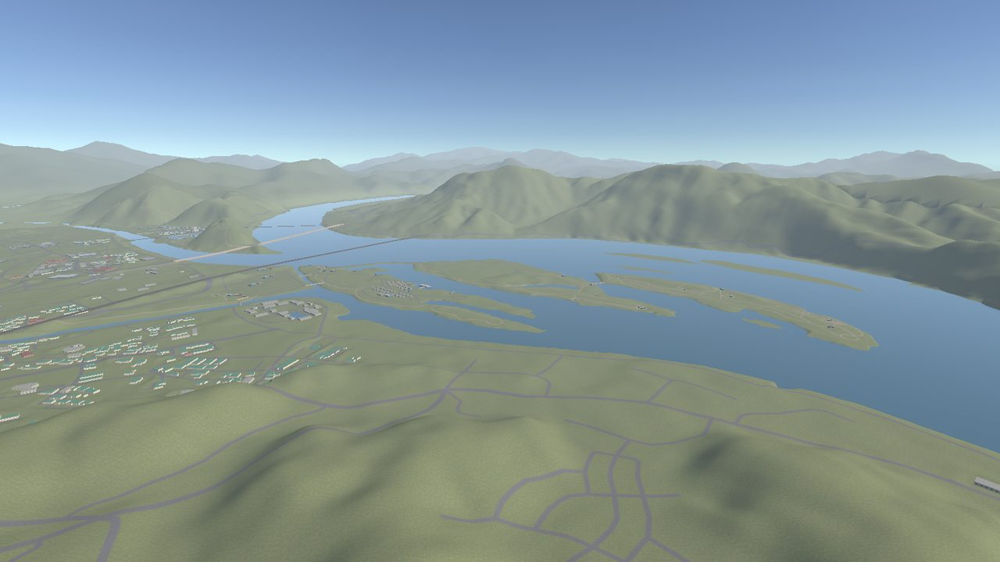
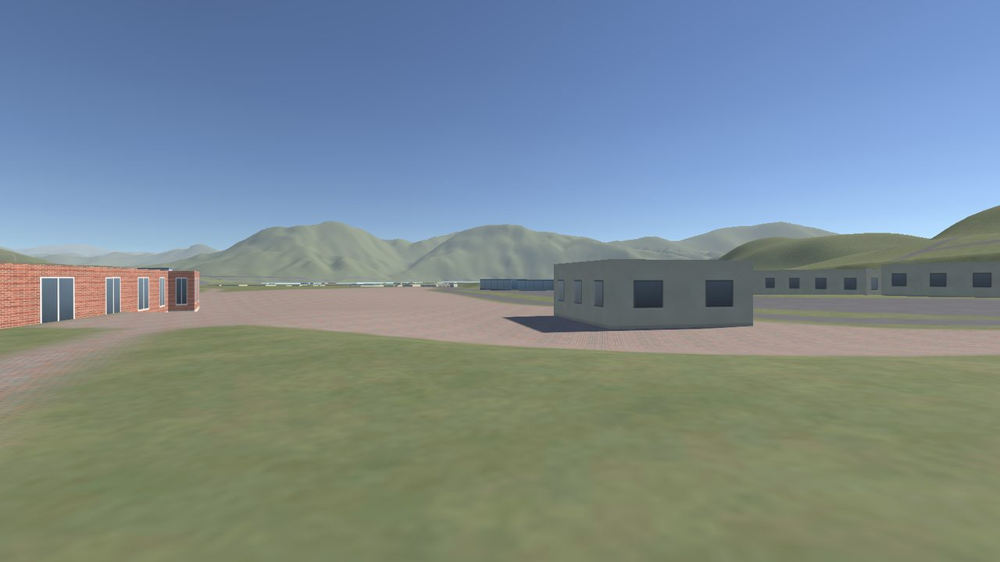

# journey_on — 가평읍 3D 가상공간

경기도 가평군 가평읍(144.86㎢)을 공공 공간정보로 Unity에 재현하는 프로젝트다. 지형과 항공 정사영상은 실측 데이터를 쓰고, 건물은 외곽선을 층수만큼 세운 블록(LOD1)으로 만든다. Python 파이프라인이 원천 데이터를 1km 타일로 변환하고, Unity 에디터 스크립트가 그 타일을 자동으로 배치한다.

범위는 단계적으로 넓힌다.
1. 관광지: 달전리 북한강 수변(자라섬, 남이섬 선착장). 남이섬은 원경으로만 넣는다.
2. 시가지: 읍내리, 대곡리
3. 읍 전역: 14개 법정리

기획서는 [`가평읍 3D 가상공간 구현 기획서.md`](가평읍%203D%20가상공간%20구현%20기획서.md)에 있다.




<sub>위 화면의 지형·건물·수면·도로는 임시 공개 데이터로 만들었다. Produced using Copernicus WorldDEM-30 © DLR e.V. 2010-2014 and © Airbus Defence and Space GmbH 2014-2018 provided under COPERNICUS by the European Union and ESA; all rights reserved. © OpenStreetMap contributors, ODbL 1.0 (openstreetmap.org/copyright)</sub>

## 현재 상태

1단계 5일 데모(지형, 건물, 수면, 도로·교량, 원경, 자유 이동, Windows 빌드, 시연 영상)를 **임시 데이터**로 만들었다.

- **쓰는 데이터:** 공식 데이터(국토지리정보원 DEM·정사영상·수치지도, 브이월드 GIS건물통합정보)는 로그인과 신청이 필요하다. 그래서 지금은 Copernicus GLO-30 DEM과 OpenStreetMap을 `interim`으로 표시해 쓴다.
- **교체 방법:** 공식 파일을 등록하고 파이프라인을 다시 돌리면 바뀐다.
- **확인 상태:** 자동 검사(`validate`)는 FAIL 0, pytest 71개와 Unity EditMode 테스트 27개는 모두 통과한다.
- **더 보기:** 남은 문제와 일정은 [`docs/PROGRESS.md`](docs/PROGRESS.md)에 있다.

## 저장소 구성

| 경로 | 내용 |
| --- | --- |
| `config/project.yaml` | 단일 설정: 좌표계, 원점, 타일, 높이맵 인코딩, 범위, 층고, 수면·교량·원경 규칙 |
| `pipeline/` | 변환 파이프라인: 수집, 타일, DEM, 건물, 수면, 도로·교량, 원경, manifest, 검사 |
| `tests/` | 파이프라인 단위 테스트(합성 데이터) |
| `unity/JourneyOn/` | Unity 6.3 LTS(URP) 프로젝트: 임포터, 보행 컨트롤러, 캡처·빌드 도구 |
| `docs/` | 결정 기록, 진행 상황, 데이터 확보 절차·이용조건, QA 점검표 |
| `qgis/`, `scripts/` | 원천 데이터를 겹쳐 보는 QGIS 프로젝트와 그 생성 스크립트 |
| `.claude/` | Claude Code 하네스: 에이전트, 스킬, 약관 가드 훅 |

`data/`(원천·변환 결과), `dist/`(빌드·영상), `_workspace/`(중간 산출물), Unity의 `Library/`와 타일 에셋은 저장소에 넣지 않는다. 모두 아래 순서로 다시 만들 수 있다.

## 준비물

- Python 3.12, [uv](https://docs.astral.sh/uv/)
- Unity 6000.3.28f1(Unity 6.3 LTS). Personal 이상 라이선스를 활성화해야 한다. 패키지(URP 17.3, glTFast 6.21.0, Input System)는 `Packages/manifest.json`에 있다.
- 선택:
  - QGIS 3.44 LTR: 원천 데이터를 눈으로 확인할 때
  - ffmpeg: 시연 영상을 만들 때

명령 예시는 Windows(Git Bash) 기준이다.

## 실행 순서

### 1. Python 환경

```bash
uv sync
.venv/Scripts/python -m pytest -q
```

### 2. 원천 데이터

공개 대체 데이터(interim)를 받는다.

```bash
.venv/Scripts/python -m pipeline fetch-open --area phase1
.venv/Scripts/python -m pipeline fetch-open --area phase1 --only osm --layers skirt_water_areas   # 원경 수면(선택)
```

공식 데이터는 [`docs/DATA_ACQUISITION.md`](docs/DATA_ACQUISITION.md)의 절차대로 받은 뒤 등록한다. 등록된 공식 레이어가 있으면 interim보다 먼저 쓴다.

```bash
.venv/Scripts/python -m pipeline inspect --path <파일>
.venv/Scripts/python -m pipeline register --layer dem --path <파일> --source "<제공처>" --license "<이용조건>"
```

### 3. 변환과 검사

```bash
.venv/Scripts/python -m pipeline all      --area phase1   # grid → dem → ortho → buildings → water → roads → skirt → export
.venv/Scripts/python -m pipeline validate --area phase1   # FAIL이 있으면 종료 코드 1
.venv/Scripts/python -m pipeline overview --area phase1   # data/out/phase1/reports/overview.png
```

결과는 `data/out/phase1/`에 생긴다. 내용은 `manifest.json`(manifest_version 2), 타일별 높이맵 RAW, `buildings.glb`, `water.glb`, `roads_mask.png`, `bridges.glb`, 원경 `skirt/skirt.glb`다. 파이프라인과 Unity 사이의 계약은 [`.claude/skills/geo-pipeline/references/manifest-schema.md`](.claude/skills/geo-pipeline/references/manifest-schema.md)에 있다.

콘솔 한글이 깨지면 `PYTHONIOENCODING=utf-8`을 붙인다.

### 4. Unity 임포트와 빌드

에디터를 연 상태에서는 `JourneyOn` 메뉴(`Import Area phase1`, `Capture QA Shots`, `Build Windows`)를 쓴다. 에디터가 닫혀 있으면 배치 모드로 실행한다. 배치 모드에서는 각 메서드가 스스로 종료하므로 `-quit`를 붙이지 않는다.

```bash
UNITY="C:/Program Files/Unity/Hub/Editor/6000.3.28f1/Editor/Unity.exe"
PROJ="$PWD/unity/JourneyOn"

# 타일 배치 → Assets/Scenes/phase1.unity
"$UNITY" -batchmode -projectPath "$PROJ" -executeMethod JourneyOn.Editor.WorldImporter.ImportFromCommandLine -area phase1 -logFile import.log
# 검수 스크린샷 → _workspace/screens/
"$UNITY" -batchmode -projectPath "$PROJ" -executeMethod JourneyOn.Editor.ShotCapture.CaptureFromCommandLine -area phase1 -logFile shots.log
# 시연 영상(ffmpeg 필요). -frames 90 으로 미리보기
"$UNITY" -batchmode -projectPath "$PROJ" -executeMethod JourneyOn.Editor.DemoCapture.CaptureFromCommandLine -area phase1 -out "$PWD/dist/demo.mp4" -logFile demo.log
# Windows 빌드 → dist/JourneyOn_<날짜>/JourneyOn.exe
"$UNITY" -batchmode -projectPath "$PROJ" -executeMethod JourneyOn.Editor.BuildScript.BuildWindows -logFile build.log
```

빌드 폴더에 생기는 `*_BurstDebugInformation_DoNotShip` 폴더는 배포할 때 뺀다.

### 5. 조작

| 키 | 동작 |
| --- | --- |
| W A S D, 마우스 | 걷기, 시점 |
| Shift / Space | 달리기 / 점프 |
| F | 비행 모드 켜기·끄기(E 위로, Q 아래로). 물 위에서는 착지할 수 없다 |
| 클릭 | 건물·교량 정보 보기 |
| Esc | 커서 잠금 풀기 |

빌드에 `-smoke <초>`를 붙이면 자동 점검 모드로 실행된다. `-smokeWalk "E,N;E,N"`를 함께 주면 그 경로를 자동으로 걷는다.

## 좌표 규약

- **좌표계와 원점:** 좌표계는 EPSG:5186이다. Unity 원점은 E 246000, N 580000(자라섬 서도 부근)이다. 1 m = 1 unit, X = 동, Z = 북, Y = 해발 표고다.
- **타일:** 1km 격자이고, 이름은 `Tile_{E km}_{N km}`(남서 모서리 기준)다. 1단계 범위는 [244000, 575000, 248000, 582000]으로 28타일이다.
- **높이맵:** 16-bit RAW 1025×1025, 리틀 엔디언, 첫 행 = 남쪽이다. 0이 −20 m, 65535가 +1180 m다. 이웃 타일과 가장자리 표본을 공유한다.
- **glTF 축:** glb는 (−E, Up, N)으로 쓴다. glTFast가 X를 뒤집어 Unity에서 (E, Up, N)이 된다.

규약을 바꾸면 [`docs/decisions.md`](docs/decisions.md)에 결정을 추가한다.

## 데이터 출처와 이용조건

- **모델링 원천:** 국토교통부·국토지리정보원 공개 데이터만 쓴다. 공식 데이터가 오기 전에는 OSM·Copernicus를 `interim`으로 표시해 쓴다.
- **금지 소스:** 카카오·네이버·구글 로드뷰와 구글 3D 타일은 약관상 캡처·가공·3D 파생이 금지되어 있다. 사람이 눈으로 검수할 때만 쓰고, 자동으로 접근하지 않는다. `.claude/hooks/license_guard.py`가 이런 접근을 막는다.
- **기록:** 레이어별 출처, 이용조건, 크레딧 문구는 [`docs/DATA_SOURCES.md`](docs/DATA_SOURCES.md)에 있다. 빌드 HUD와 시연 영상에도 같은 크레딧을 넣는다.

## Claude Code 하네스

`.claude/`에는 이 프로젝트용 Claude Code 에이전트·스킬 구성이 들어 있다.
- 에이전트 4개: 데이터 수집, 변환 파이프라인, Unity, 독립 검증
- 스킬 5개
- 약관 가드 훅

"다음 작업 진행해", "N일차", "검수해" 같은 요청을 받으면 `journey-on-orchestrator` 스킬이 `docs/PROGRESS.md`를 읽고 작업을 나눠 맡긴다. 그다음 독립 검증을 거쳐 결과를 기록한다. 규칙은 [`CLAUDE.md`](CLAUDE.md)에 있다.

## 문서

- [`docs/PROGRESS.md`](docs/PROGRESS.md): 일정, 진행 상황, 알려진 문제
- [`docs/decisions.md`](docs/decisions.md): 결정 기록 D-001~D-013
- [`docs/DATA_ACQUISITION.md`](docs/DATA_ACQUISITION.md): 공식 데이터 받는 절차
- [`docs/DATA_SOURCES.md`](docs/DATA_SOURCES.md): 출처·이용조건·크레딧 문구
- [`docs/qa/playtest_checklist.md`](docs/qa/playtest_checklist.md): 직접 조작 검수 점검표
- [`docs/qa/roadview_checklist.md`](docs/qa/roadview_checklist.md): 로드뷰 육안 대조 점검표
